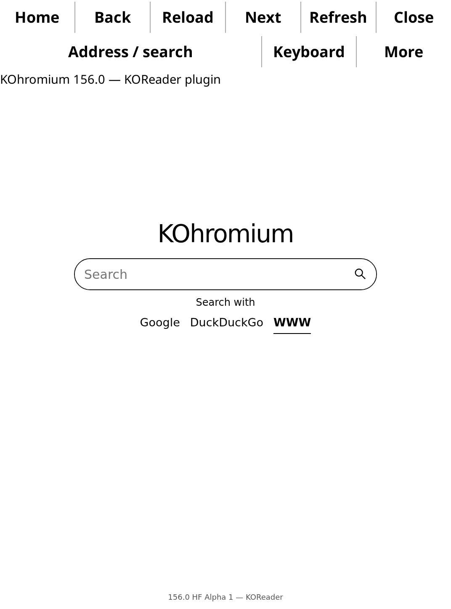
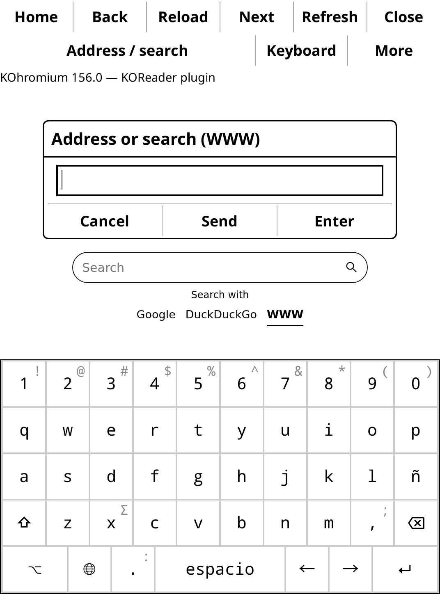

# KOhromium — 156.0 HF Alpha 1

Chromium 156 **inside KOReader**, with KOReader-native controls, menus and its on-screen keyboard. This is a real Lua plugin, not a shortcut to the GTK2 Khromium application. Pages render in a KOReader widget; Close returns to the underlying reader without exiting KOReader.

**Experimental first build. The plugin has been tested on the official KOReader Linux runtime with real Chromium, but has not been tested on a physical Kindle.**

**AI disclosure:** developed with substantial AI assistance, including generated code, tests and documentation. Independent project, unaffiliated with Amazon, KOReader or Chromium.



## Supported target

- Jailbroken **Kindle Paperwhite 4, firmware 5.17.1 (hard-float)**, with KOReader already installed.
- KOReader **v2026.07.1** is the version used for desktop integration testing. Other versions may require adjustments.
- This package is not for PW3/soft-float firmware, Kobo, Android or other KOReader platforms. The Lua interface uses KOReader APIs, but the bundled engine/runtime is specific to ARMv7 HF Linux and the Kindle integration target.
- Approximately 260 MB storage plus browsing data. The PW4's 512 MB RAM is a tight limit: KOReader remains running alongside Chromium, so large books and heavy sites may exhaust memory.

## Install

1. Close KOReader and other Chromium/Khromium instances.
2. Download the full `KOhromium-156.0-HF-Alpha-1-PW4.zip` from Releases and extract it into the Kindle USB root:

```text
Kindle USB root/
  kohromiumld.so
  koreader/
    plugins/
      kohromium.koplugin/
        _meta.lua
        main.lua
        kohromium_browser.lua
        kohromium_engine.lua
        kohromium_transport.lua
        engine.sh
        assets/
        engine/
        runtime/
        licenses/
```

3. If KOReader is installed elsewhere, move the **whole** `kohromium.koplugin` folder into that installation's `plugins/` directory. The loader must remain at `/mnt/us/kohromiumld.so`.
4. Eject safely, restart KOReader and choose **KOhromium → Open browser** in its main menu (normally grouped with tools/plugins).

No KUAL launcher, GTK2 window or X11 frontend is used. There is no need to install Khromium separately. The `koreader/plugins/kohromium.koplugin/state/` directory contains this plugin's profile/preferences. Khromium's folders, loader and data are not overwritten.

To uninstall, close the browser and KOReader, then remove `kohromium.koplugin/` and `kohromiumld.so`. Removing the state directory deletes this browser's saved data.

## Use

- **Home / Back / Reload / Next**: navigation, reload and forward history.
- **Address / search**: KOReader's native text dialog/keyboard. Under More, choose WWW/direct address, Google or DuckDuckGo. WWW adds `https://` to an address; text containing spaces requires a search provider.
- **Touch a text input or textarea**: a native KOReader edit dialog opens with the current field value. Edit using the reader's keyboard and choose **Send** or **Enter**. Enter also sends a browser Enter key event. Password inputs use KOReader's password dialog mode. Characters/layouts, including Spanish ñ, come from the KOReader keyboard configuration.
- **Keyboard**: manually open a text dialog to send text to the currently focused page field. This first build edits the field in a dialog, rather than embedding a live keyboard below the page.
- **Swipe** the page to scroll. More → Page arrows sends arrow keys to the page/focused field.
- **Refresh** requests KOReader's full screen refresh. The plugin does not call `eips` behind KOReader's framebuffer manager.
- **More**: Favorites, History, search provider, Android 11/Debian 13 user agent, page zoom (50–250%), homepage and cookies.
- **Close**, the Back/Esc device action, or More → Return to KOReader closes the engine and restores the underlying KOReader view. Suspend and screen-size/rotation changes also close the browser in this alpha; choose orientation in KOReader before opening it.



## How it works

A native Lua frontend starts the local Chromium headless engine and communicates through a private Unix socket mapped to Chromium's debugging pipe descriptors. There is no remote server or TCP debugging port. Screenshot PNGs become KOReader BlitBuffers; KOReader owns rendering, touch input, dialogs and e-ink refresh.

The engine/runtime comes from Khromium 156.0 HF: Chromium headless-shell **156.0.8078.73 ARMhf**, private Debian 12/glibc 2.36 libraries and a separate loader. Only the engine ELF interpreter path changes to `/mnt/us/kohromiumld.so`. No Chromium engine source rebuild or firmware modification is claimed. See [third-party notices](THIRD_PARTY_NOTICES.md).

## Validation and limits

See [VALIDATION.md](VALIDATION.md). Desktop tests use the official KOReader runtime and real Chromium, not mock widgets. Physical Kindle behavior, Wi-Fi/HTTPS, suspend behavior, memory use and long sessions remain unverified. Screenshots are from a virtual desktop display, not the Kindle.

Known scope of this alpha:

- One page/view, no simultaneous tabs, downloads, audio/video support, extensions or desktop Chromium UI.
- Text-input/textarea editing is supported; rich contenteditable editors and fields inside cross-origin iframes are not implemented.
- Dialog editing commits the whole field when Send/Enter is selected; it is not continuous live typing into the website. Some complex websites may require special handling.
- Page captures run at about one frame per second and may be delayed during navigation. Animations and video are unsuitable.
- Native KOReader UI sizing/orientation is used. The GTK2 application's separate UI-scale, KUAL Full Page mode and settings windows are not ported into this first plugin build.
- Chromium runs **without its sandbox**. A browser exploit could access files available to KOReader's user. HTTPS certificate verification remains enabled; there are no automatic engine security updates. This is a new experimental integration, not a device-certified browser.

If startup fails, inspect `kohromium.koplugin/state/engine.log` and KOReader's `crash.log`. Review logs before sharing; do not upload the state/profile directory or cookies.

## Development

The plugin is Lua source; there is no GTK2 frontend binary to compile. Install it in a KOReader `plugins/` directory and restart KOReader. Distinct `kohromium_*` module names avoid collisions with other plugins. Desktop testing can set `KOHROMIUM_TEST_ENGINE` to a native headless-shell executable; this override is disabled on Kindle.

The engine integration and UI tests are under `tests/`. The full packager takes the existing Khromium HF ZIP for its engine, private runtime and licenses:

```sh
python3 scripts/package.py --base /path/Khromium-156.0-HF-PW4.zip \
  --output /path/KOhromium-156.0-HF-Alpha-1-PW4.zip
```

Build inputs, profiles and downloaded KOReader test binaries are not included in the source archive. Original plugin code is MIT-licensed. The engine, runtime and KOReader retain their own licenses.
